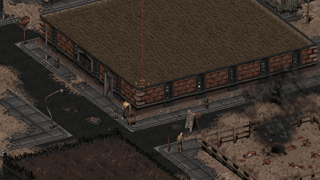
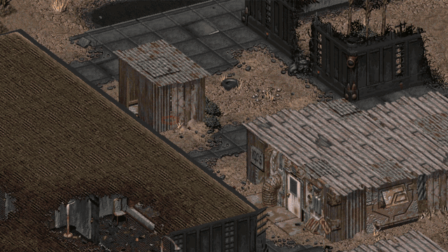
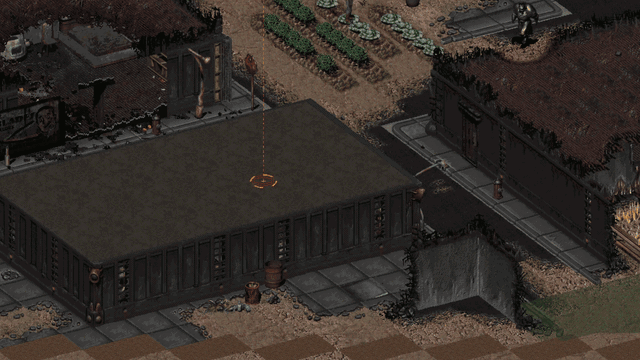
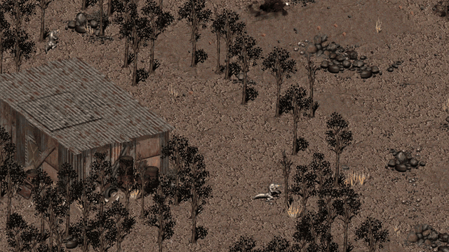
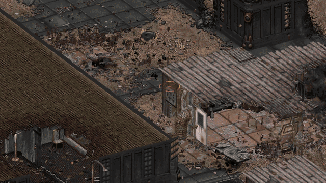
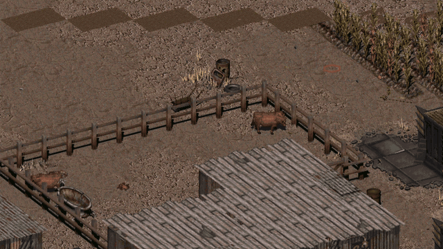
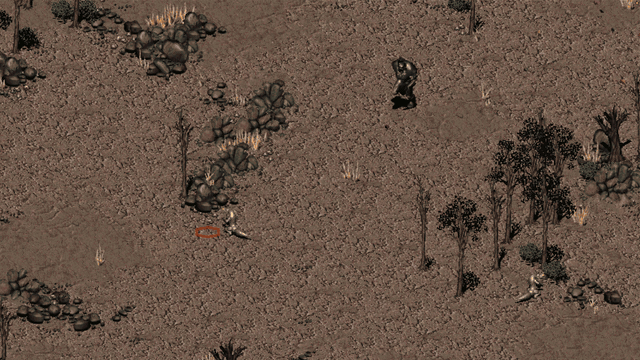

# Wrecked Fallout 2



Wrecked Fallout 2 is a Fallout 2 mod where explosions break things. It is a modified version of [Fallout 2 Community Edition](https://github.com/alexbatalov/fallout2-ce) (fallout2-ce) for Windows and macOS. You need your own copy of the game; this repository has no game files.

- Grenades, rockets and dynamite blow holes in walls, knock down scenery and break through roofs.
- Debris flies in each wall's own material: stone crumbles, wood splinters, metal tears with sparks, glass shatters and tents tear into rags.
- Whatever a blast leaves hanging in the air comes down.
- Craters, scorch marks and rubble stay on the ground, and the damage is kept in your saves.
- X calls an orbital beam down at the cursor; it follows the cursor for two seconds, burning through roofs and setting off blasts.
- G drops a meteor on the cursor; it breaks more, and wider, than any explosion.

The beam and the meteor are the game's own explosions: they throw people back and hurt everyone near, the player too.

## In action

<table>
<tr><td><br>Meteors smash wooden shacks</td><td><br>Roofs break from above</td></tr>
<tr><td><br>A house in the woods blown apart</td><td><br>The beam burns a wooden house</td></tr>
<tr><td><br>The beam hits the brahmin pen</td><td><br>Meteors vs geckos</td></tr>
</table>

Website: [breakvanilla.com](https://breakvanilla.com/). Videos: [youtube.com/@BreakVanilla](https://www.youtube.com/@BreakVanilla).

## Install

Download the zip for your system from Releases and follow the `README.txt` in it ([`wrecked/package/README.txt`](wrecked/package/README.txt)).

## What is in this repository

- `patches/`: the mod's changes to fallout2-ce, one patch per part: build settings and the program's name (`01-build`), the mod itself in the new files `src/destruct.cc` and `src/destruct.h` (`02-destruct`), its hooks into the game's explosions, drawing, maps and saves (`03-game-hooks`), mouse and trackpad input and finding the game folder (`04-input-and-platform`), and the hidden test runs (`05-test-runs`).
- `build.sh`: on the first run clones fallout2-ce into `local/engine/` at upstream commit `e97087b` of https://github.com/alexbatalov/fallout2-ce and applies `patches/`. Then it builds the program.
- `tools/update-patches.sh`: writes engine changes back into `patches/`.
- `cmake/mingw-w64-x86_64.cmake`: CMake toolchain for the Windows build.
- `wrecked/wrecked-fallout-2/`: what the game reads, `sprites.dat` (debris art) and `wrecked.ini` (settings, each explained in the file).
- `wrecked/render_assets.py`: Blender script that renders the debris, puffs, craters and rubble at 8 times game size, as grey shade maps that the game colours by what blew up.
- `wrecked/pack.py`: shrinks the renders and writes `sprites.dat`. `wrecked/preview.py` draws every sprite for a quick look.
- `wrecked/install.sh`: puts the Mac build into the local game folder.
- `wrecked/test_game.sh`, `wrecked/test_run.sh`, `wrecked/sheet.py`: hidden test runs, and test frames side by side.
- `wrecked/dat2.py`, `wrecked/frm.py`: read `master.dat` and FRM art.
- `wrecked/package.sh`, `wrecked/package/README.txt`: the player zips and their README.

## Building

The engine builds with CMake, as fallout2-ce does; SDL2, zlib and fpattern are downloaded and built with it. The Windows build cross-compiles on a Mac with `brew install cmake mingw-w64`.

```sh
# Mac (Apple Silicon and Intel) in local/build-universal, Windows in local/build-windows
./build.sh

# The two zips, in local/dist/
wrecked/package.sh
```

`./build.sh mac` or `./build.sh windows` builds only one of them; arguments starting with `-D` go to CMake. The Windows exe needs only Windows' own DLLs. `package.sh` refuses test builds.

To play the build, put the unpacked Windows version of Fallout 2 (the folder with `master.dat`, for example from `innoextract` of the GOG installer) in `local/game/`. Git ignores `local/`, so no game file can be pushed; `FALLOUT2_GAME` points the scripts to another game folder. `wrecked/install.sh` copies the Mac build there and links `wrecked/wrecked-fallout-2/` into it, so a new `sprites.dat` is live at the next start. Start `local/game/Wrecked Fallout 2.app` to play.

## Changing the engine

`local/engine/` is a plain git clone of fallout2-ce and is not part of this repository; `git -C local/engine status` lists the files the mod changes and adds, and `git -C local/engine diff HEAD` shows the changes. Edit the code there, then run `tools/update-patches.sh` to write the changes back into `patches/`. `build.sh` warns when `local/engine/` has changes that are not in `patches/` yet. If a changed file is in none of the five patches, `update-patches.sh` stops; add it to `PARTS` in the script.

To move to a newer fallout2-ce: run `tools/update-patches.sh`, move `local/engine/` away, set `F2CE_REV` in `build.sh` to the new upstream commit and run `build.sh`. Patches that do not apply cleanly leave conflict markers in `local/engine/`; fix them, run `tools/update-patches.sh` and build again.

## How the mod works

- Debris takes its material from the proto of what breaks: stone, cement and dirt, wood, metal and plastic, glass, or leather (tents).
- When a wall breaks, the roof around the blast gets a hole where there is a floor under it. Wall tops over a hole and scraps of roof cut off from the rest fall. Only stone walls keep a broken foot.
- The beam sets off a blast every 0.22 s. Its blasts hurt everyone within 3 hexes and count as the player's attack. The game plays one explosion at a time; blasts during another one only break things.
- The meteor breaks walls out to 4 hexes and caves in the roof.
- Over a roof, the beam, the meteor and X hit the ground under it. `tileRoofCovers` in `src/tile.cc` checks every roof tile around the cursor, because the game's `_square_roof_intersect` misses where roof tiles overlap.
- `DESTRUCT.DAT` next to each save holds the decals and the damage masks of walls, scenery and roofs. It keeps a checksum of its `SAVE.DAT`, so a save over the slot by a program without the mod makes it ignored.

## Rebuilding the art

The Python scripts need numpy, pillow and scipy, for example in a `.venv` in the repo root: `uv venv .venv && uv pip install --python .venv/bin/python -r wrecked/requirements.txt`. The renders go to `wrecked/work/`, which git ignores.

```sh
cd wrecked
/Applications/Blender.app/Contents/MacOS/Blender -b --python render_assets.py -- work/render
# or only some groups: rocks, puffs, craters, piles, materials
/Applications/Blender.app/Contents/MacOS/Blender -b --python render_assets.py -- work/render materials
../.venv/bin/python pack.py work/render wrecked-fallout-2/sprites.dat
```

## Test runs

`./build.sh test` makes the test build in `local/build-test`. `wrecked/test_run.sh NAME [VAR=value ...]` runs it hidden, without touching the mouse, on `MAP` (default `artemple.map`), and exits. Mac only.

Test runs use a copy of `local/game/` with its own saves and settings, in `~/Library/Caches/wrecked-fallout-2/game` (`WRECKED_TEST_DIR` moves it); `wrecked/test_game.sh` resets it. Frames as PNG and `log.txt` go to `destruct-NAME/` next to the copy.

Three explosions in Modoc, a save and a load, then a frag grenade at the nearest critter:

```sh
MAP=modmain.map wrecked/test_run.sh m1 DESTRUCT_TEST=23938,22133,21936 DESTRUCT_TEST_DAMAGE=80 DESTRUCT_TEST_SAVE=10
MAP=modmain.map wrecked/test_run.sh g1 DESTRUCT_TEST= DESTRUCT_TEST_THROW=25
```

`WRECKED_TEST_SLOT` starts the test from a save of the test copy. It and `DESTRUCT_TEST_SAVE` count from 0, so 10 is the game's slot 11. `DESTRUCT_MAKE_SAVES="2=modmain.map=Modoc;3=klatrap.map=Klamath"` makes saves: it gives the player explosives, goes to each map and saves to that slot, counted from 1 as in the game. A rocket at the nearest critter, in leather armor (the tribal outfit has no art for holding a rocket launcher):

```sh
WRECKED_TEST_SLOT=2 wrecked/test_run.sh r1 DESTRUCT_TEST= DESTRUCT_TEST_THROW=13 DESTRUCT_TEST_AMMO=14 DESTRUCT_WEAR=1 DESTRUCT_TEST_FRAMES=400
```

The beam from the player's tile plus 593 tiles, dragged to plus 990; the meteor at minus 206; the meteor at screen point 150,280 (`DESTRUCT_TEST_AIM_BEAM=1` for the beam). `DESTRUCT_LIST=1` prints what stands near the player, by offset:

```sh
WRECKED_TEST_SLOT=3 wrecked/test_run.sh beam1 DESTRUCT_TEST_BEAM=+593,+990
WRECKED_TEST_SLOT=1 wrecked/test_run.sh met1 DESTRUCT_TEST_METEOR=-206
WRECKED_TEST_SLOT=3 wrecked/test_run.sh aim1 DESTRUCT_TEST_AIM=150,280
```

- `DESTRUCT_WEAR=1 DESTRUCT_ADD_ITEMS=14:60 DESTRUCT_RESAVE=Name`, with `WRECKED_TEST_SLOT`, puts on leather armor, adds 60 explosive rockets and saves the slot again as Name. With it, `DESTRUCT_STRENGTH=10`, `DESTRUCT_LEVEL=12` and `DESTRUCT_HP=500` raise the player's Strength, level and hit points, and `DESTRUCT_WIELD=13:14` loads a rocket launcher from the inventory's rockets and puts it in the right hand. `DESTRUCT_LIST=1` also prints the player's level, hit points, Strength, carried weight and inventory; `DESTRUCT_TEST_THROW` throws the player's own item when the inventory has one.
- `ARCH=x86_64` runs the Intel half of the test build under Rosetta; `BUILD=` runs another build folder.

## Licence

fallout2-ce is under the Sustainable Use License ([`LICENSE.md`](LICENSE.md)), and so is this mod: it may be used, changed and shared free of charge, for non-commercial purposes. The packages also contain SDL2 and zlib (zlib licence), fpattern (MIT) and, on Windows, the MinGW-w64 runtime; their licences are in `wrecked-fallout-2/LICENSES`.

Fallout 2 is a trademark of Bethesda Softworks. This is a free fan mod, not made or endorsed by Bethesda. Neither this repository nor the packages contain files from the original game.
